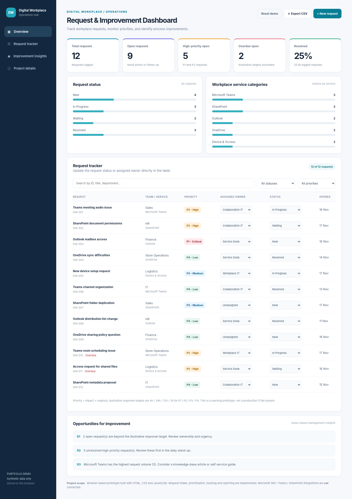

# Digital Workplace Request & Improvement Dashboard

**Portfolio prototype | November 2026 | HTML, CSS, JavaScript**

An offline digital workplace operations prototype designed around the responsibilities of an IT / digital workplace internship: processing cross-functional requests, identifying operational bottlenecks, and presenting concise improvement opportunities. **This is a fictional demonstration with synthetic data; it is not connected to Lidl, Microsoft 365, or any production service.**

## Run the demo (free; no installation)

1. Download and unzip the project.
2. Open `index.html` in Chrome or Edge. If your browser restricts local-file storage, run `python -m http.server 8000` inside the unzipped project folder and open `http://localhost:8000`.
3. Explore sample requests and KPIs, update any owner or status, or click **+ New request**.
4. Use **Export CSV** to save the current records for Excel. **Reset demo** restores synthetic examples.

All state remains in your browser's `localStorage` until you reset it or clear site data. It is not shared between devices. Do not enter real employee information or confidential details.



## Features actually implemented

- Structured request intake for Teams, SharePoint, Outlook, OneDrive, device/access and general workplace topics.
- Deterministic impact × urgency categorization into P1/P2/P3/P4 priorities.
- Status workflow: New → In Progress → Waiting → Resolved; editable assigned owner.
- KPIs: total, active, high-priority open, illustrative SLA-overdue and resolution rate.
- Summary charts by status and workplace service category.
- Search, filters, recommendations and Excel-compatible CSV export.
- Preloaded synthetic requests; responsive browser interface.

### Why this project is relevant

| Internship activity | Prototype evidence |
|---|---|
| Cross-functional digital workplace topics | Requests from multiple departments and tool categories |
| Small operational concepts | Prioritization matrix, target response times, ownership and handover workflow |
| Support to day-to-day operations | Tracker, follow-up statuses, overdue monitoring and reports |
| Continuous improvement | Category trends and rules-based suggestions for self-service documentation |

## Business rules (for demonstration only)

Impact and urgency are scored 1–3. A product of 9 = P1; 6 = P2; 3–4 = P3; 1–2 = P4. Illustrative target response windows: P1 = 4h, P2 = 24h, P3 = 72h, P4 = 7 days. These values **are illustrative training assumptions**, not Lidl or ITIL standards. Resolved requests are never counted as overdue. The dashboard uses the user's local computer time for measuring elapsed time since request creation.

## Test

With Node.js installed:

```sh
node --test tests/test_core.js
```

The tests cover prioritization, KPI consistency, resolved-request SLA handling, CSV escaping, and insight generation.

## Repository layout

- `index.html` – accessible dashboard interface and request form
- `styles.css` – responsive visual styling
- `core.js` – pure business functions / priority and KPI rules
- `app.js` – UI, browser storage, filtering and export
- `tests/test_core.js` – automated rule tests
- `data/example_requests.csv` – export of the original synthetic sample
- `PROJECT_BRIEF.md` – problem statement, stakeholders, KPIs and implementation roadmap

## Known limitations and possible next steps

- Data is browser-local and single-user; no server, database, or user permissions.
- No real Microsoft 365, Teams, SharePoint, Power Automate, Microsoft Graph or ServiceNow integration.
- This is a **process operations prototype**, not an enterprise ticket platform.
- Proposed extension: integrate with a controlled SharePoint list or Power Automate flow in an eligible developer tenant, add role-based views, audit log, service catalogue, and feedback surveys. Access to a Microsoft developer sandbox is subject to eligibility and administration.

## Suggested interview demo (3 minutes)

1. Explain the fictional scenario: an international organization needs visibility of workplace service requests.
2. Create a SharePoint request with team-wide impact and high urgency; show automated P2.
3. Assign an owner and move the task to `In Progress`.
4. Show how the request affects the open/high-priority KPIs and dashboard.
5. Export CSV for reporting, then describe next steps toward an actual Microsoft 365 workflow.

**CV wording:** “Built a browser-based prototype to register, prioritize and monitor cross-functional digital workplace requests; implemented KPI reporting and CSV export (HTML/CSS/JavaScript).”
